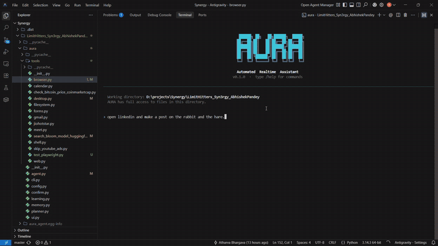
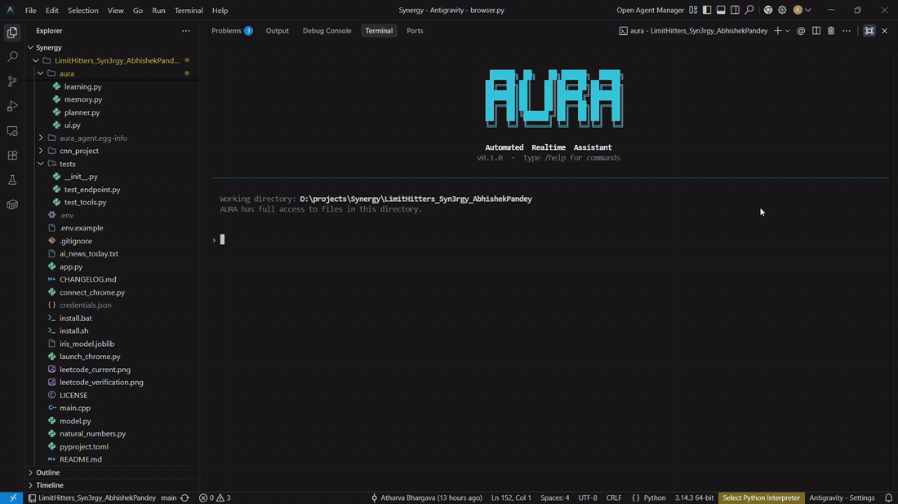
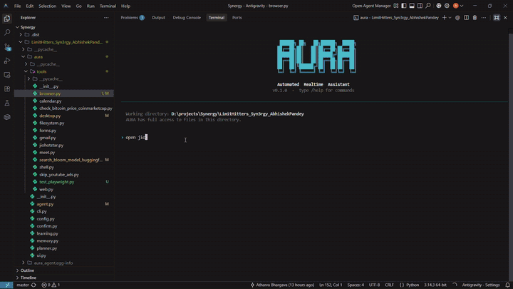
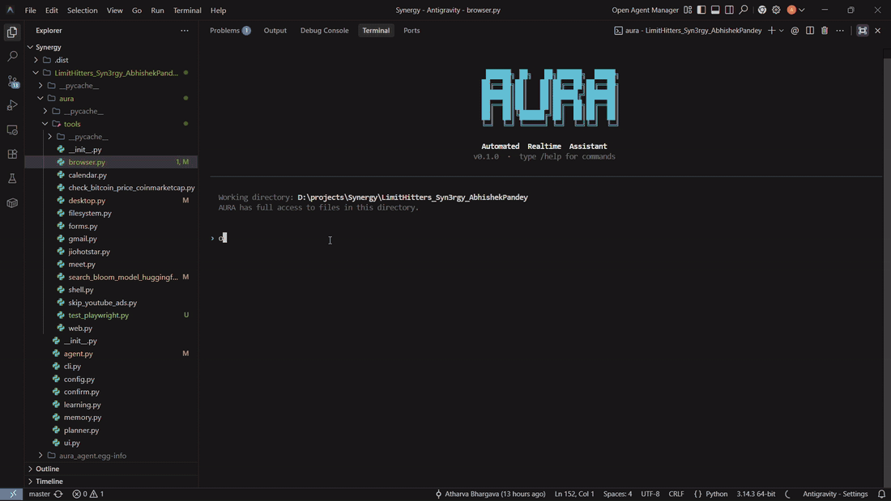

# AURA - Automated Realtime Assistant

A CLI-based autonomous AI agent that plans, executes, and adapts. Powered by open-weight LLMs via an OpenAI-compatible endpoint, AURA is designed to bridge the gap between simple text-based AI assistants and full-fledged system operators. 

From writing complete projects in an IDE to utilizing custom computer vision for desktop interaction, AURA interacts with your operating system the same way you do.

---

## Demos

Each clip is a single prompt typed (or spoken) into `aura run`. AURA plans the steps and carries them out on its own. The previews are sped up, so click any of them to watch the full recording.

### 1. Writes and publishes a LinkedIn post

Prompt: *"open linkedin and make a post on the rabbit and the hare"*

AURA opens Chrome on the logged-in profile, writes the story into the post composer, and clicks Post.

<a href="https://github.com/abhishek-pandey7/Abhisheks-Zone/blob/main/public/videos/aura-automatedlinkedinpost.mp4"></a>

[Watch the full video](https://github.com/abhishek-pandey7/Abhisheks-Zone/blob/main/public/videos/aura-automatedlinkedinpost.mp4)

### 2. Voice to code

Prompt (spoken via `/voice`): *"give me CNN code for mnist dataset"*

AURA transcribes the request, plans it, and writes a complete PyTorch MNIST CNN with data loading, model, training and evaluation.

<a href="https://github.com/abhishek-pandey7/Abhisheks-Zone/blob/main/public/videos/aura-multimodality-voice%20to%20cnn%20code.mp4"></a>

[Watch the full video](https://github.com/abhishek-pandey7/Abhisheks-Zone/blob/main/public/videos/aura-multimodality-voice%20to%20cnn%20code.mp4)

### 3. Finds and plays IPL highlights on JioHotstar

Prompt: *"open jiohotstar, search for RCB vs DC highlights and play the first video"*

AURA launches the app from the Start menu, searches for the match, and starts playback.

<a href="https://github.com/abhishek-pandey7/Abhisheks-Zone/blob/main/public/videos/aura-opens%20jiohotstar%20and%20plays%20ipl%20match%20highlights%20on%20its%20own.mp4"></a>

[Watch the full video](https://github.com/abhishek-pandey7/Abhisheks-Zone/blob/main/public/videos/aura-opens%20jiohotstar%20and%20plays%20ipl%20match%20highlights%20on%20its%20own.mp4)

### 4. Searches YouTube and plays a video

Prompt: *"open youtube, search for sidemen and play the first youtube video"*

AURA opens the browser, runs the search, and plays the top result.

<a href="https://github.com/abhishek-pandey7/Abhisheks-Zone/blob/main/public/videos/aura-opens%20youtube%20searches%20for%20a%20channel%20and%20plays%20the%20first%20vid.mp4"></a>

[Watch the full video](https://github.com/abhishek-pandey7/Abhisheks-Zone/blob/main/public/videos/aura-opens%20youtube%20searches%20for%20a%20channel%20and%20plays%20the%20first%20vid.mp4)

---

## 1. Overview

You provide a goal in natural language. AURA takes that goal, breaks it down into a chronological sequence of steps, and autonomously executes each step using a suite of native tools (shell execution, filesystem manipulation, web browsing, and raw desktop input). 

Unlike simple code-generation tools, AURA operates in an **Observe -> Think -> Act -> Verify** feedback loop. If a test fails, a layout changes, or an error is thrown, AURA reads the output, adjusts its plan, and tries a new approach without needing manual intervention.

Example Execution Trace:
```text
$ aura run

> Build a simple Flask web hook, write tests, run them, and ensure it passes.

Plan
  1. Create project directory and initialize Python files.
  2. Implement Flask app with a basic POST endpoint.
  3. Write pytest test suite.
  4. Run tests and self-correct any failures.

Action      bash         $ mkdir hook_test && cd hook_test
Action      write_file   hook_test/app.py
Action      write_file   hook_test/test_app.py
Action      bash         $ cd hook_test && pytest -v
Observation 1 failed, 0 passed
Action      patch_file   hook_test/app.py   (Self-Correcting issue)
Action      bash         $ pytest -v
Observation 1 passed
```

---

## 2. Advanced Capabilities

AURA goes significantly beyond shell and file manipulation. It incorporates profound systems designed for complex operating workflows:

### Full-Screen Spatial Desktop Vision
AURA does not rely purely on text matching or hardcoded coordinates. It features a complete **Desktop Vision Engine** capable of reading the entire screen layout. It generates a structured spatial map of text and UI elements. This allows AURA to:
- Intelligently understand the visual hierarchy of an application.
- Perform coordinate-based interaction, scrolling, and hover-based navigation on any application, even those not strictly accessible via an API.
- Recover from aggressive bot protection or captchas by visually parsing interfaces.

### Imitation Learning ("Watch and Learn")
AURA can learn directly from your behavior. By activating Imitation Learning, AURA uses `pynput` to listen to your mouse clicks, keyboard inputs, and navigation habits. It captures these user actions and passes them to a Vision-Language Model (VLM) code generation pipeline. 
This pipeline synthesizes your organic workflow into reusable Python macros utilizing `pyautogui`. Once generated, AURA dynamically registers these new macros at runtime, adding them permanently to its toolchain. 

### Persistent Browser Automation
AURA does not just use stateless HTML scraping. It incorporates headless and non-headless browser automation (utilizing Playwright) that integrates directly with your active Chrome profiles. This enables:
- A deterministic navigation sequence: Launch, focus Chrome, navigate to a target URL, and interact seamlessly.
- State persistence: Logins and cookies from your active Chrome profile allow AURA to perform tasks as an authenticated user.
- Real-time interaction with elements like search bars, infinite scrolling feeds, and dynamically generated single-page applications.

### Deep Integration Capabilities
AURA features dedicated automation pipelines for standard office workflows:
- **Google Meet & Calendar**: Autonomously schedule video conferences, draft meeting agendas, and dynamically email Google Meet links to intended participants.
- **Google Forms**: Interactively fill out complex web forms relying on a secure, locally-stored user profile and historical context.

---

## 3. Tool Architecture

AURA is equipped with a vast tool registry. The agent decides precisely when and how to deploy these tools.

*   **Filesystem Controls**: Read documents, overwrite source files, incrementally patch files, create/delete directories.
*   **Shell Controls**: Execute bash or windows command prompt operations. Read STDOUT and STDERR to verify outcomes.
*   **Web Engine**: Pure HTTP retrieval, localized scraping, and pure web searching to inject research before generating code.
*   **Desktop Controls**: Control the mouse matrix, simulate keyboard events at the OS level, deploy Windows OCR and Tesseract screen captures.
*   **Playwright Engine**: Fully capable Chrome orchestration for front-end manipulation.

---

## 4. How it Differs from Cloud Coding Assistants

| Feature | Cloud Assistants (e.g., Claude Code, Codex) | AURA |
| --- | --- | --- |
| Underlying LLM Engine | Proprietary (Anthropic/OpenAI) | Agnostic / Self-hostable (Any OpenAI-compatible API) |
| Architecture Philosophy | Reactive to simple instructions | Proactive upfront Task Planning |
| Desktop & Computer Vision | No | Yes (OS-level Mouse/KB bindings & OCR map generation) |
| Organic Imitation Learning | No | Yes (Macro generation via pynput/VLM) |
| Browser Handling | Limited HTML curl | Native Playwright bindings with Profile Persistence |
| Confirmation Guards | Yes | Yes (Granular Y/N safeguards for Destructive actions) |
| Complete Autonomy | Low, prompts constantly | High, handles multi-hour execution chains |

---

## 5. Software Architecture

```
aura/
|-- __init__.py
|-- cli.py              Command Line entry point
|-- ui.py               Rich Terminal UI, spinners, and REPL loop integration
|-- agent.py            The core LLM prompt loop. Feeds observations back into memory.
|-- planner.py          Converts overarching instructions into ordered subtask structures.
|-- memory.py           Abstracts conversation persistence, contextual truncation, and state saving.
|-- learning.py         Imitation learning loop, VLM code synthesis, and runtime macro injection.
|-- confirm.py          Prompts human-in-the-loop validation for sys-admin actions.
|-- config.py           Validates and orchestrates the environment config payload.
|-- tools/
    |-- shell.py        Isolated subprocess deployment.
    |-- filesystem.py   Advanced string manipulation and file targeting.
    |-- browser.py      AURA browser automation engine targeting Playwright.
    |-- web.py          General HTTP handlers.
    |-- desktop.py      Windows/macOS computer vision interface.
    |-- forms.py        Automated data filling engine.
    |-- meet.py         Conference scheduler integration.
    |-- ...             (various generated action macros)
```

---

## 6. Installation

Provide the necessary execution credentials in a configuration file:
```bash
git clone https://github.com/abhishek-pandey7/AURA-Automated-Realtime-Assistant
cd AURA-Automated-Realtime-Assistant
cp .env.example .env
```

### macOS / Linux automated setup
```bash
bash install.sh
source .venv/bin/activate
aura run
```

### Windows automated setup
```bat
install.bat
.venv\Scripts\activate
aura run
```

### Manual Dependency Installation
```bash
python3 -m venv .venv
source .venv/bin/activate        # Windows: .venv\Scripts\activate
pip install -e ".[all]"          # Core only: pip install -e .
playwright install chromium      # To support browser tooling
```

### Optional extras

The core install covers the agent loop plus shell, file and web tools. Everything else is an extra, and tools whose extra isn't installed are simply skipped:

| Extra | Adds |
| --- | --- |
| `browser` | Playwright browser automation |
| `desktop` | Mouse/keyboard control, screen OCR (Windows), watch-and-learn recording |
| `voice` | `/voice` speech input and spoken notifications |
| `google` | Gmail, Calendar, Meet and Forms tools |
| `all` | Everything above |

```bash
pip install -e ".[desktop,google]"
```

### Use AURA as a Python library

```python
from aura import Agent

agent = Agent(
    api_key="sk-...",                         # or set INFERX_API_KEY
    base_url="https://api.openai.com/v1",     # any OpenAI-compatible endpoint
    model="gpt-4o-mini",
)
print(agent.run("create hello.py that prints hi, then run it"))
```

Give the agent your own tools. The schema is built from the function signature:

```python
@agent.add_tool
def get_order_status(order_id: str) -> str:
    """Look up an order's shipping status."""
    return lookup(order_id)
```

Useful options:

- `plan=False` skips the planner and runs the goal as a single task.
- `verbose=False` turns off the terminal output.
- `approve=callback` replaces the Y/N prompt for risky actions, for scripts with no terminal: `approve=lambda action, detail: False` declines everything. `safe_mode` and `approve` apply to the whole process.
- `agent.plan(goal)` returns the planned subtasks without running them, and `agent.tools` lists the available tool names.

Importing `aura` never needs an API key; `Agent()` raises `aura.ConfigError` with setup instructions if none is configured.

---

## 7. Configuration Details

Modify your locally generated `.env` file to dictate how AURA behaves.

| Variable | Description | Example Default |
| --- | --- | --- |
| INFERX_BASE_URL | Base URL of the endpoint | https://api.openai.com/v1 |
| INFERX_API_KEY | Authorization API key | sk-xxx (Required) |
| INFERX_MODEL | Targeting Model | gemma-4-31b |
| AURA_SAFE_MODE | Demand human verification for destructive tool deployments | true |
| AURA_HOME | Where sessions, learned tools, Google credentials and the form profile live | ~/.aura |
| AURA_CHROME_PROFILE | Chrome profile used by the browser tool | your OS's default Chrome profile |
| AURA_USER_NAME | Name used in the spoken "task completed" message | (none) |

AURA reads `.env` from the current directory, then `~/.aura/.env`, then the source checkout. Google `credentials.json`/`token.json` and `user_profile.json` are read from the checkout root if they're already there, otherwise from `AURA_HOME`.

---

## 8. Platform Specific Setup and Troubleshooting

### macOS (Apple Silicon & Intel)
The `pyaudio` and `SpeechRecognition` libraries require native system dependencies in order to parse host-level audio successfully. The `install.sh` sequence usually handles this via Homebrew. If you prefer to install manually:

```bash
# Needed for internal audio processing and /voice commands
brew install portaudio flac
pip install -e .

# Manual Fix: SpeechRecognition on Apple Silicon ships an x86 flac binary by default.
# The following script explicitly assigns the native ARM flac binary to the Python package.
FLAC_DST=".venv/lib/$(python3 -c 'import sys; print(f"python{sys.version_info.major}.{sys.version_info.minor}")')/site-packages/speech_recognition/flac-mac"
cp /opt/homebrew/bin/flac "$FLAC_DST"
```

### Windows
Normally all dependencies correctly install via typical `pip` channels. On some environments `pyaudio` lacks a pre-compiled wheel for your python distribution:
```bat
pip install pipwin
pipwin install pyaudio
```

*Note: The native `desktop_find_text` and vision toolkit incorporates Windows native UI SDK (`winsdk`) for OCR, running exceptionally fast on Windows environments. Cross-platform counterparts substitute internal libraries as needed.*

---

## 9. Comprehensive CLI & REPL Commands

Initiating the CLI:

| CLI arguments | Output |
| --- | --- |
| `aura run` | Starts the interactive continuous session |
| `aura run "Target Context"` | Submits a single task instruction, completes it, and exits |
| `aura version` | Display tool version information |

In-session Agent REPL Controls:

| Target Command | Execution Result |
| --- | --- |
| `/voice` | Engages Speech-To-Text pipeline for hands-free queries |
| `/help` | Explains all commands |
| `/clear` | Generates a clean slate by purging the context window |
| `/sessions` | Parses and lists serialized past execution chains |
| `/resume` | Hooks an old execution chain back into the present context |
| `/tools` | Dumps the locally detected tool payloads |
| `/learn` | Manually invokes the Imitation Learning capture stream |
| `/cwd` | Returns the current scope path |
| `/exit` | Gracefully terminate |

---

## 10. Verification & Tests

To run the verification suite and ensure that your host configuration has correctly bonded with AURA's toolkit:
```bash
# Validates local filesystem, shell, and offline capability functions
python tests/test_tools.py

# Validates connectivity and handshakes with the inference server
python tests/test_endpoint.py
```

---

## 11. Dependencies List

AURA bridges multiple complex open-source libraries.

| Package | Purpose | Platform |
| --- | --- | --- |
| **openai** | Universal mapping to standard LLM endpoints | All |
| **rich** | Renders formatted syntax, tables, and progress indicators | All |
| **requests** | Low level network manipulation and API access | All |
| **beautifulsoup4** | Standardizing HTML trees | All |
| **playwright** | Deep orchestration of WebKit and Chromium processes | All |
| **python-dotenv** | Inject configurations to the environment safely | All |
| **PyAutoGUI** | Abstraction of mouse and keyboard simulations | All |
| **pynput** | Hardware hook extraction for Imitation Learning algorithms | All |
| **Pillow** | Memory processing of visual data and screen captures | All |
| **SpeechRecognition** | Decodes array segments to semantic strings | All |
| **pyaudio** | Live PCM translation from active system microphones | All |
| **pyttsx3** | Local text-to-voice synthesization | All |
| **winsdk** | Native, ultra-low-latency OCR engine mappings | Windows |

---

## 13. Future Scope

AURA is under active development. Our roadmap for future enhancements includes:

*   **Multi-Agent Orchestration**: Enabling multiple AURA instances to collaborate on large-scale engineering projects.
*   **Long-term Memory (RAG)**: Implementing a vector-based persistent memory system to allow the agent to remember project contexts and user preferences across multiple months.
*   **Cloud-Native Deployment**: Simplified, one-click deployment templates for AWS, GCP, and Azure with pre-configured virtual desktop environments (VNC/RDP) for vision-based tasks.
*   **Dockerized Infrastructure**: A fully containerized version of AURA designed for high-availability execution in CI/CD pipelines and remote clusters.
*   **Web Dashboard**: A central management interface to monitor execution traces, manage secrets, and interact with remote AURA instances via a web browser.
*   **Native IDE Plugins**: Deep integration with VS Code and JetBrains for a more seamless "pair programming" experience.

